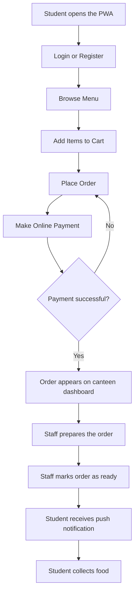

# Online Canteen Food-Ordering System

**Name:** Vyshnav Madineni
**USN:** NB25CSE192
**Assigned Case Study:** Question 2 – Mobile and Web Applications Engineering

---

## 1. Introduction

College canteens are busiest during short breaks, especially at lunch time. Students often spend a large part of their break standing in a queue, while canteen staff have to take orders manually and manage several customers at once. An online food-ordering system can make this process faster, clearer and more convenient for everyone.

Before choosing how to build the system, it is important to understand the available options:

- A **mobile application** is installed on a phone through an app store. It can use phone features such as the camera, GPS and push notifications.
- A **web application** runs in a browser and is opened through a link. It does not need to be installed and can be used on almost any device.
- A **Progressive Web Application (PWA)** is a web application with app-like features. It can be added to a phone's home screen, load some content offline and send notifications.

---

## 2. Problem Analysis

At present, students have to visit the canteen counter, wait in line, place their order verbally and then wait again for it to be prepared. This manual process can lead to long queues, missed orders and confusion about whether food is ready.

The college needs a system that allows students to browse the menu, place an order, make an online payment and receive a notification once the food is ready for collection. Since the system may be used by hundreds of students on different phones, it should be simple to access, reliable during peak hours and affordable to develop and maintain.

---

## 3. Proposed Solution

### 3.1 Comparison of Approaches

| Criteria | Native Mobile App | Web App | PWA |
| --- | --- | --- | --- |
| Installation | Downloaded from an app store | No installation required | Optional: add to home screen |
| Codebase | Usually separate for Android and iOS | One codebase | One codebase |
| Development cost | High | Low | Low |
| Push notifications | Yes | Limited | Yes |
| Offline support | Yes | No | Partial, such as a cached menu |
| Updates | User may need to update the app | Available instantly | Available instantly |
| Device features | Full access | Limited access | Moderate access |

### 3.2 Selected Approach: Progressive Web Application

A Progressive Web Application is the best option for this canteen system because it provides a practical balance between convenience, cost and useful mobile features.

First, a single codebase can be used by students on Android and iPhone devices, as well as by canteen staff using a computer. This reduces both development time and future maintenance costs. Students also do not have to visit an app store or use storage space on their phone; they can simply open a link and begin ordering.

The PWA can send push notifications to let students know when their food is ready. Menu updates, price changes and bug fixes can be published immediately without waiting for app-store approval. It can also cache the menu so that it opens faster and remains partly usable when the campus internet connection is weak.

A native app would provide more device access, but that is unnecessary for a food-ordering system and would be more expensive to build for both Android and iOS. A normal web app would be easy to create, but it would not offer the same app-like experience or dependable notification support as a PWA.

### 3.3 Major Functionalities

1. **Menu browsing:** Students can view food items, prices, categories and availability. Search and filters help them find an item quickly.
2. **Order placement:** Students can add items to a cart, select a pickup time and confirm their order.
3. **Online payment:** Payments can be made through UPI, cards or wallets, followed by a digital receipt.
4. **Order-status notifications:** Canteen staff update the order status from a dashboard, and students receive a notification when their order is ready.

### 3.4 Application Workflow

---

## 4. Benefits and Challenges

### Expected Benefits

- Students spend less time waiting in queues and can collect food when it is ready.
- Digital orders reduce misunderstandings and mistakes when recording items.
- Canteen staff can view incoming orders in real time and plan preparation more efficiently.
- The college gains useful information about popular food items and busy ordering periods.

### Development Challenges

1. **Payment integration and security:** The system must connect safely to a payment gateway and protect personal and payment information. HTTPS, secure authentication and tokenised payments are important.
2. **Peak-hour demand:** Many students may place orders at the same time during lunch breaks. The backend must be able to handle this traffic without becoming slow or unavailable.
3. **Device and notification compatibility:** The PWA must work well across different browsers and screen sizes. Push-notification support can vary, particularly on iPhones, where users may need to add the PWA to their home screen first.

---

## 5. Conclusion

An online canteen food-ordering system can reduce queues, minimise manual-order errors and give students a more convenient way to buy food. Among the available approaches, a Progressive Web Application is the most suitable choice because it is easy to access, cost-effective to maintain and still offers useful features such as notifications and limited offline access.

With secure payment handling and a backend designed for busy lunch periods, the system can improve the daily experience for both students and canteen staff.
